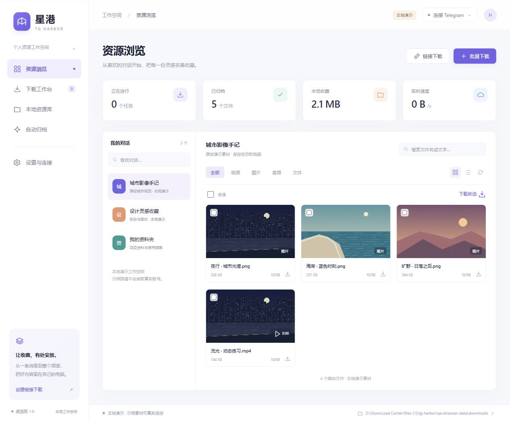

# 星港 · TG Harbor

Windows Telegram 资源助手，首个公开版本 **1.0.0**。

- [下载 Windows 完整包](docs/downloads/TG-Harbor-Windows-1.0.0.zip)
- [下载 1.0 源码包](docs/downloads/TG-Harbor-Source-1.0.0.zip)
- [下载校验值](docs/downloads/SHA256.json)
- [项目主页源码](docs/index.html) / [GitHub Pages 发布说明](PUBLISHING.md)



参考 [TG-FF 公开工作流程](https://tg-ff.com/v4/)，独立实现的 Windows Telegram 资源助手。包含可实际写入文件的本地演示，以及使用 [Telethon](https://docs.telethon.dev/en/stable/) 的真实 Telegram 接入。没有复制 TG-FF 程序、商标或私有实现。

## 使用 Windows 程序

打开发布文件夹中的 **TG-Harbor.exe**。首次启动默认进入本地演示，不连接你的 Telegram，不读取其他软件的登录数据。

1. 进入「设置与连接」或点击右上角「连接 Telegram」。
2. 在 [my.telegram.org/apps](https://my.telegram.org/apps) 获取你自己的 **API ID / API Hash**，填入程序的连接表单。获取方式见 [Telegram 官方说明](https://core.telegram.org/api/obtaining_api_id)。API Hash 输入后通过 Windows DPAPI 加密存储，不需要发到聊天中。
3. 如需代理，勾选 SOCKS5，填写自己的地址和端口，例如 `127.0.0.1:7890`；程序不自动读取系统代理或其他软件的配置。
4. 点击连接，使用手机 Telegram 的「设置 → 设备 → 扫描二维码」授权；若启用两步验证，在程序中输入密码。密码不写入配置和日志。
5. 授权后浏览自己的对话，选择媒体下载；也可以添加 `t.me/频道/消息编号` 或 `t.me/c/编号/消息编号` 链接。

## 已实现

- 真实 Telegram 对话列表（最近最多 200 个对话）、按需浏览媒体，每页扫描 200 条消息，支持继续载入历史。
- 按类型、文件名或消息文字筛选，网格与列表视图，单个或选择多个媒体下载。
- 公开 / 私有 / 话题消息链接解析。私有对话需要当前账号有访问权限；链接任务不会自动加入群组。
- 批量扫描最近 1–1000 条消息，可按媒体类型、关键词、日期与文件大小筛选。
- SQLite 持久任务队列、真实进度与速度、暂停 / 继续 / 失败重试、按消息去重。
- Telegram 下载使用分块流，断点对齐后续传；文件大小不匹配时保留临时文件并提示重试。重启后未完成任务暂停。
- 原媒体身份变化检测，避免把不同媒体混入同一个断点文件。
- 下载按来源对话归档。本地图片 / 视频 / 音频预览，打开所在文件夹。
- 指定对话的新媒体自动归档，可按类型、关键词和大小筛选。软件运行且账号已连接时生效。
- 下载目录设置、演示 / Telegram 模式切换、本地会话保留与退出。

演示模式的频道和素材均为程序随附示例。点击下载会真实复制到本地，队列与文件进度来自实际处理，没有伪造远程下载。

## 数据位置

默认 `data` 位于程序旁边：数据库 `harbor.sqlite3`、账号会话 `telegram.session`、Windows 加密凭据、下载目录及 WebView 缓存。只访问程序自己的数据以及你在界面中指定的下载目录。Telegram 会话由 Telethon 按其标准格式保存在本机；API Hash 的 Windows 加密与会话文件是不同的保存机制。

程序的本地服务只监听 `127.0.0.1`，接口使用随机会话令牌；不提供公网后台。不会向他人发送消息、自动转发或自动加入频道。

## 范围与限制

此版本着重实现浏览、下载、任务管理与自动归档；不包含 TG-FF 的批量发送、DOCX 导出、Stream 建站、支付或多账号系统。遵循 Telegram 的账号访问与限流规则，不保证下载服务器不允许获取的内容。单任务串行下载；自动归档只处理开启规则后的新消息，历史内容通过批量任务扫描。

真实账号的授权和在线下载需要你自己的 API 设置与手机授权。交付前可验证本地演示、HTTP 接口、队列持久化，以及隔离模拟的 Telegram 分块 / 断点下载；没有使用你的 Telegram 账号做在线测试。

Windows 原生窗口使用 [pywebview](https://pywebview.flowrl.com/guide/installation.html) 与 Microsoft Edge WebView2。若 WebView2 不可用，程序会打开浏览器作为备用界面；备用模式仍可下载，运行进程需要手动关闭。程序启动错误可查看 `data/startup-error.txt`。

## 从源码运行

需要 Python 3.12（开发和打包环境）。

```powershell
python -m venv .venv
.\.venv\Scripts\python.exe -m pip install -r requirements.txt
.\.venv\Scripts\python.exe app.py
```

本地浏览器调试：

```powershell
.\.venv\Scripts\python.exe app.py --headless --port 8787
```

本次启动的界面地址写入程序数据目录的 `runtime.json`，保留完整片段参数打开。

验证与打包：

```powershell
.\.venv\Scripts\python.exe -m unittest discover -s tests -v
powershell -File build.ps1
```

随附的 `web/assets` 是原创本地演示素材，源码可自由修改。图片素材生成脚本是 `make_assets.py`；视频是由该原创图片生成的 6 秒运镜片段。下载与运行时不需要 FFmpeg。
